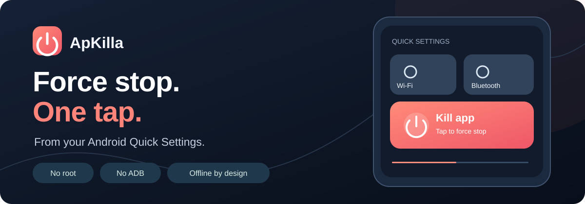
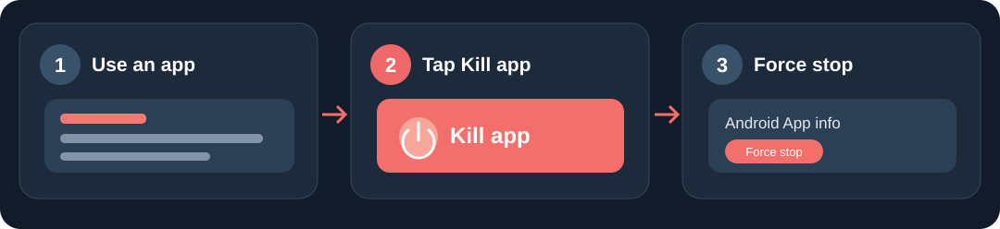

<p align="center"></p>

<p align="center">
<a href="https://github.com/Bl0ck154/ApKilla/releases/latest"></a>
<a href="https://github.com/Bl0ck154/ApKilla/actions/workflows/build.yml"></a>
<a href="LICENSE"></a>

</p>

<p align="center"><strong>One Quick Settings tile. No root, ADB, Shizuku, Tasker, account, or Internet permission.</strong></p>

<p align="center">
<a href="https://github.com/Bl0ck154/ApKilla/releases/latest"><strong>Download APK</strong></a> ·
<a href="https://bl0ck154.github.io/ApKilla/">Website</a> ·
<a href="#getting-started">Getting started</a> ·
<a href="https://github.com/Bl0ck154/ApKilla/issues/new/choose">Report a bug</a>
</p>

> [!NOTE]
> **Latest stable: v0.4.0.** This release includes more reliable Accessibility handling and local diagnostics. Android Settings controls differ by device; report problems with your phone model and Android version.

## What ApKilla does

ApKilla is a small, offline Android app that opens the system **App info** screen for the app you're using, then uses Accessibility to press **Force stop** and confirm it. You trigger the sequence with **Kill app** in Quick Settings.

| One action | No root or debugging | Private by design |
| :--- | :--- | :--- |
| Tap the tile while using an app. | No ADB, Shizuku, wireless debugging, or Tasker. | No Internet permission, analytics, account, or telemetry. |

<p align="center"></p>

<sub>Illustrative diagram, not a real device screenshot. Android Settings may flash briefly.</sub>

## Getting started

1. **Install** the [latest signed stable APK](https://github.com/Bl0ck154/ApKilla/releases/latest).
2. **Enable** **ApKilla automation** in your Android Accessibility settings.
3. **Add** **Kill app** to Quick Settings.
4. **Use an app**, pull down Quick Settings and tap **Kill app**.

If ApKilla can't identify the current app safely, it refuses the operation. If Android disconnects the Accessibility service, open ApKilla and check its status.

## Downloads

| Edition | Purpose | Link |
| --- | --- | --- |
| **v0.4.0 — stable** | Latest signed APK | [Download release](https://github.com/Bl0ck154/ApKilla/releases/tag/v0.4.0) |
| **v0.3.5 — previous** | Older signed APK | [Previous release](https://github.com/Bl0ck154/ApKilla/releases/tag/v0.3.5) |

## Compatibility and limitations

- **Android 7.0+ (API 24).** System Settings layouts and Accessibility availability vary by manufacturer.
- Android can disable or disconnect Accessibility services. There is no guaranteed way for a standard app to keep them connected on every device.
- Some protected apps cannot be force-stopped; others can restart immediately.
- A successful confirmation tap is **not** independent proof that Android stopped the target.
- Pending actions expire after 10 seconds. ApKilla avoids system UI, launchers, Settings, and its own package.

Read the [OEM compatibility notes](COMPATIBILITY.md) and [troubleshooting guide](TROUBLESHOOTING.md). Version 0.4.0 adds **Last action** and **Copy diagnostics** to help investigate failures.

## Security and privacy

Accessibility lets an app inspect UI content. ApKilla uses it to track window changes and automate the system Force stop UI only when you tap the tile. It requests no Internet permission. The app does not send data to a server. [Privacy details](PRIVACY.md) · [Automation source](app/src/main/java/com/block154/apkilla/KillAccessibilityService.java).

## Build from source

Requires JDK 17, Android SDK 35 and Gradle 8.9.

```bash
./gradlew :app:testDebugUnitTest :app:assembleDebug
```

CI runs unit tests and a debug build. Signed releases use a permanent certificate checked during the release workflow ([signing details](SIGNING.md)). Published releases cannot be overwritten with a new APK using the same tag.

## Contribute

If ApKilla works—or doesn't—on your phone, a [device-specific report](https://github.com/Bl0ck154/ApKilla/issues/new/choose) helps. Please include Android and OEM skin versions, but redact personal screen content and identifiers.

[Contributing](CONTRIBUTING.md) · [Changelog](CHANGELOG.md) · [Security](SECURITY.md) · [Privacy](PRIVACY.md) · [MIT license](LICENSE)

---

<p align="center"><sub>Independent open-source Android utility. Not affiliated with any Android device manufacturer.</sub></p>
