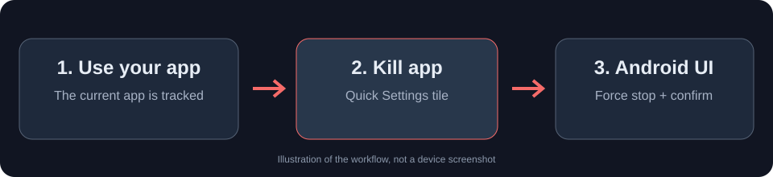

# ApKilla

**Force-stop the Android app you're using from a Quick Settings tile.**

ApKilla opens the selected app's Android **App info** screen and uses Accessibility to tap **Force stop** and confirm. You tap the **Kill app** tile once. The Settings screen may briefly appear during the process.

No root, ADB, wireless debugging, Shizuku, Tasker, account, or Internet permission.

[**Download the signed APK**](https://github.com/Bl0ck154/ApKilla/releases/latest) · [Report a bug](https://github.com/Bl0ck154/ApKilla/issues/new/choose) · [How it works](#how-it-works)



## Set up

1. Download the latest signed APK from [GitHub Releases](https://github.com/Bl0ck154/ApKilla/releases).
2. Open ApKilla and enable **ApKilla automation** under Android's Accessibility settings.
3. Add **Kill app** to Quick Settings, then return to the app you want to stop.
4. Pull down Quick Settings and tap **Kill app**.

ApKilla must be able to observe the current foreground app before opening Quick Settings. If it cannot determine a safe target, it refuses the operation. If Accessibility is disconnected, open ApKilla and check whether Android has disabled its service.

## How it works

A regular Android app cannot silently force-stop another package through a public Android API. ApKilla automates the phone's built-in App info screen:

1. An Accessibility service tracks foreground window changes.
2. The Quick Settings tile uses the current, live foreground target.
3. Android opens that package's **App info** screen.
4. ApKilla finds **Force stop** and the confirmation control.
5. The app records whether the request was sent or failed. A successful tap is **not** independently verified as a completed force-stop.

The automation intentionally avoids system UI, launchers, Settings, and ApKilla itself. It won't kill an old remembered app after an Accessibility disconnect. A request expires after 10 seconds.

## Compatibility and limitations

- Requires Android 7.0+ (API 24).
- Uses the Android Accessibility service. Its connection, Settings layout, and Force stop dialogs vary by OEM and Android release.
- The app currently includes button selectors for standard Android plus some translated controls; **no device-wide compatibility claim is made**.
- If your phone restricts background Accessibility services, Android may disable or disconnect ApKilla until you re-enable it.
- Some protected/system apps cannot be stopped through Android Settings.
- A tap on a confirmation control is not proof that the process stopped. If the app stays active, report your device and Android version.

See [Troubleshooting](TROUBLESHOOTING.md) and [Compatibility](COMPATIBILITY.md).

## Privacy

ApKilla has **no Internet permission** and no analytics or telemetry. It stores the last foreground package locally to drive the Quick Settings action, and it stores a small local history of operation outcomes without package names. Nothing is uploaded. See [PRIVACY.md](PRIVACY.md).

Accessibility access is powerful. Review the [source code](app/src/main/java/com/block154/apkilla/KillAccessibilityService.java) before enabling it if you are unsure.

## Build and test

Requires Android SDK 35, JDK 17, and Gradle 8.9.

```bash
gradle :app:testDebugUnitTest :app:assembleDebug
```

Signed release APKs are produced by GitHub Actions from explicit `v*` tags. Release signing uses a permanent key stored in GitHub Secrets and verified against a published certificate fingerprint; see [SIGNING.md](SIGNING.md). The private key is never committed.

## Contribute

Bug reports with the phone model, Android version, OEM skin, and reproducible steps are particularly useful. Do not post sensitive screen contents or personal data in logs.

See [CONTRIBUTING.md](CONTRIBUTING.md), [CHANGELOG.md](CHANGELOG.md), and the [MIT license](LICENSE).
